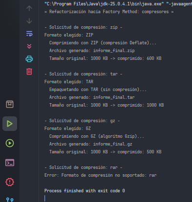

# Ejercicio 08 – Refactorización de código acoplado hacia Factory Method

## Descripción

Una aplicación heredada usaba bloques condicionales anidados, repetidos por todo el código, para instanciar compresores de archivos (ZIP, TAR, GZ). Este ejercicio refactoriza ese diseño hacia Factory Method.

Código heredado (el "antes"):

```java
Compressor compressor;
if (format.equals("zip")) {
    compressor = new ZipCompressor();
} else if (format.equals("tar")) {
    compressor = new TarCompressor();
} else if (format.equals("gz")) {
    compressor = new GzCompressor();
} else {
    throw new IllegalArgumentException("Formato desconocido");
}
compressor.compress(file);
```

## Objetivos

- Eliminar los condicionales de instanciación de la lógica de negocio.
- Reemplazarlos por polimorfismo e inversión de control.
- Separar la lógica de selección de la lógica de compresión (principio de responsabilidad única).

## Implementación del patrón Factory Method

| Rol en el patrón | Clase |
|---|---|
| Producto (interfaz) | `Compressor` |
| Productos concretos | `ZipCompressor`, `TarCompressor`, `GzCompressor` |
| Creador (abstracto) | `CompressorCreator` (método de fábrica `createCompressor()`) |
| Creadores concretos | `ZipCompressorCreator`, `TarCompressorCreator`, `GzCompressorCreator` |
| Responsabilidad de selección | `CompressorCreatorRegistry` + `CompressionFormat` |
| Responsabilidad de compresión | `CompressionService` |
| Cliente | `Main` |

`CompressionService` recibe un `CompressorCreator` (clase abstracta) y nunca menciona un compresor concreto. La selección ocurre en `CompressorCreatorRegistry`, que usa un mapa en lugar de `if`/`else`.

## Propósito de la clase

| Clase | Propósito |
|---|---|
| `Compressor` | Interfaz común: `compress()` y `getFormatName()`. |
| `ZipCompressor` / `TarCompressor` / `GzCompressor` | Compresión simulada de cada formato. |
| `CompressionResult` | Resultado con nombre de salida y tamaños. |
| `CompressorCreator` | Declara el método de fábrica. |
| Creadores concretos | Cada uno construye su compresor. |
| `CompressionFormat` | Enumeración de formatos y conversión desde texto. |
| `CompressorCreatorRegistry` | Selecciona el creador según el formato (única responsabilidad: seleccionar). |
| `CompressionService` | Comprime archivos (única responsabilidad: comprimir). |
| `Main` | Prueba los formatos soportados y uno no soportado (`rar`). |

## Concepto clave

Refactorizar significa **mover la decisión** de `if`/`else` dispersos hacia una jerarquía de creadores y un único punto de selección. El código de negocio pasa a depender de abstracciones, y agregar un formato nuevo no obliga a modificar la lógica existente.

## Resultado



## Conclusión

El diseño resultante es más flexible, más fácil de mantener y cumple el principio de responsabilidad única: una clase selecciona, otra comprime y otras crean. Se eliminaron los condicionales rígidos del código heredado.
